# Ex. No : 1 - Data Cleaning Process

# AIM
To read the given data and perform data cleaning and save the cleaned data to a file.

# Explanation
Data cleaning is the process of preparing data for analysis by removing or modifying data that is incorrect ,incompleted , irrelevant , duplicated or improperly formatted. Data cleaning is not simply about erasing data ,but rather finding a way to maximize datasets accuracy without necessarily deleting the information.

# Algorithm
STEP 1: Read the given Data

STEP 2: Get the information about the data

STEP 3: Remove the null values from the data

STEP 4: Save the Clean data to the file

STEP 5: Remove outliers using IQR

STEP 6: Use zscore of to remove outliers

# Coding and Output

```py
import pandas as pd
import numpy as np
import seaborn as sns
import matplotlib.pyplot as plt
from scipy import stats
```


```py
#READ CSV FILE HERE

data_set = pd.read_csv('/content/Data_set.csv')
iris = pd.read_csv('/content/iris.csv')
heights = pd.read_csv('/content/heights.csv')
loan_data = pd.read_csv('/content/Loan_data.csv')

datasets = {
    'Data_set': data_set,
    'Iris': iris,
    'Heights': heights,
    'Loan_data': loan_data
}
```


```py
#DISPLAY THE INFORMATION ABOUT CSV AND RUN THE BASIC DATA ANALYSIS FUNCTIONS
for name, df in datasets.items():
    print('\nDATASET:', name)
    display(df.head())
    print('Shape:', df.shape)
    print('Columns:', df.columns.tolist())
    df.info()
    display(df.describe(include='all'))
```

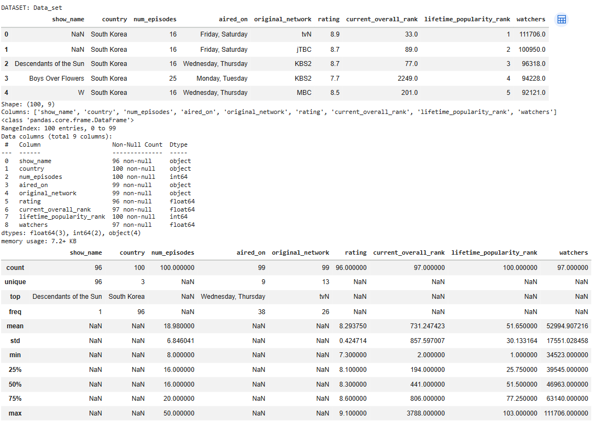

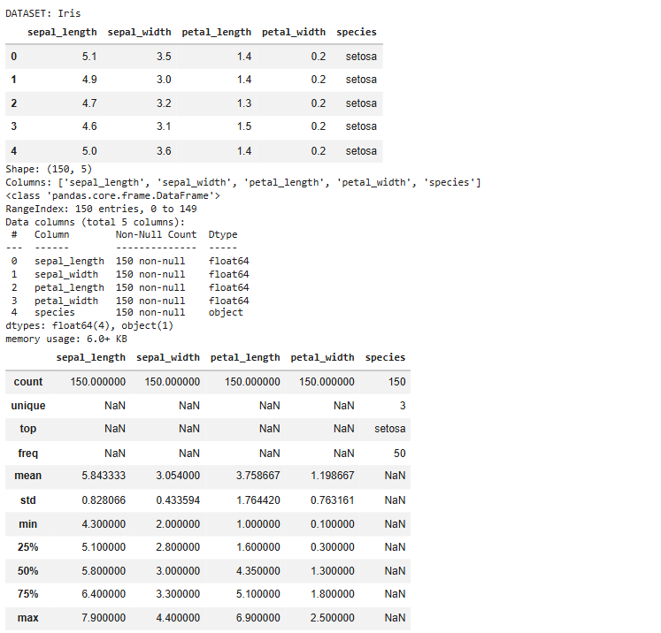

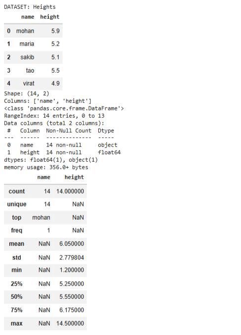

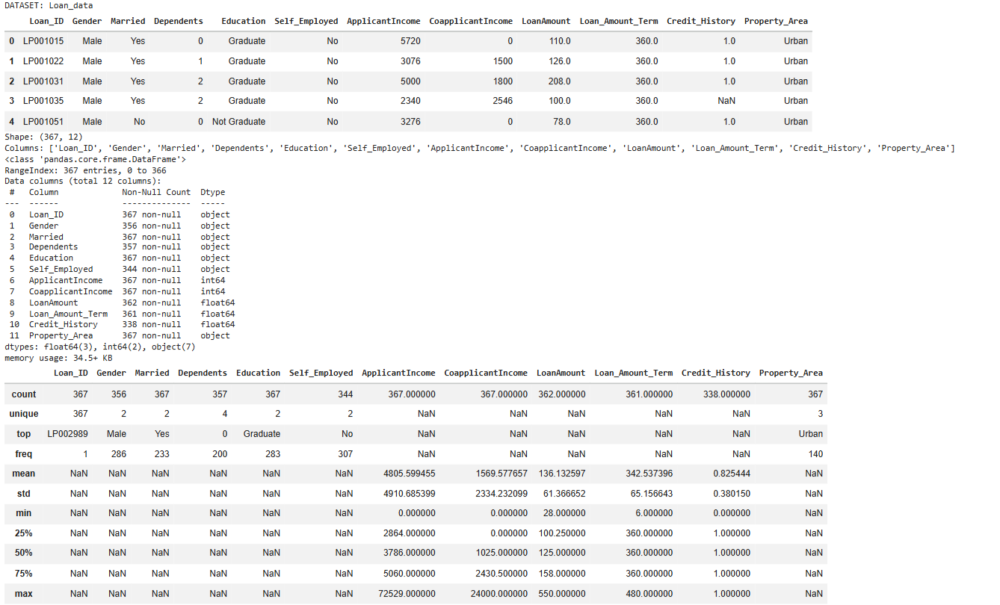


```py
#CHECK OUT NULL VALUES IN DATA SET USING FUNCTION

for name, df in datasets.items():
    print('\n', name)
    print(df.isnull())
```

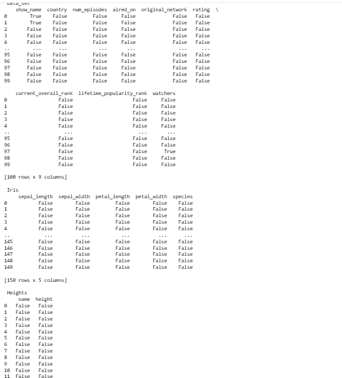

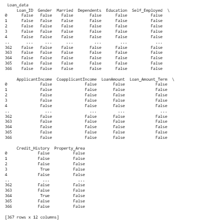


```py
#DISPLAY THE SUM ON NULL VALUES IN EACH ROWS
for name, df in datasets.items():
    print('\n', name)
    print(df.isnull().sum(axis=1))
```

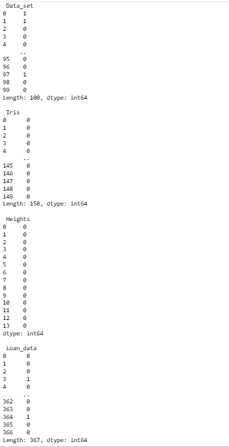


```py
#DROP NULL VALUES
for name, df in datasets.items():
    result = df.dropna()
    print(name, '- original shape:', df.shape, '| after dropna:', result.shape)
    display(result.head())
    
```
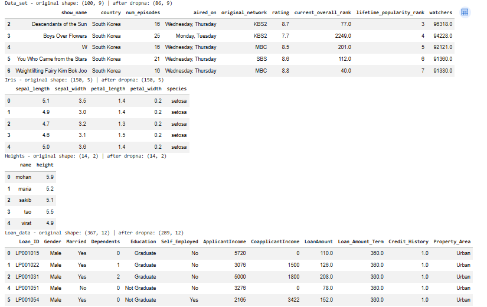


```py
#FILL NULL VALUES WITH CONSTANT VALUE "0"
datasets_zero = {name: df.fillna(0) for name, df in datasets.items()}
for name, df in datasets_zero.items():
    print(name, 'remaining null values:', df.isnull().sum().sum())
```

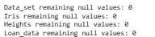

```py
#FILL NULL VALUES WITH ffill OR bfill METHOD
datasets_ffill = {name: df.ffill() for name, df in datasets.items()}
datasets_bfill = {name: df.bfill() for name, df in datasets.items()}

for name in datasets:
    print(name, '- ffill remaining nulls:', datasets_ffill[name].isnull().sum().sum())
    print(name, '- bfill remaining nulls:', datasets_bfill[name].isnull().sum().sum())
```
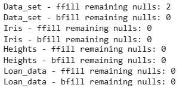

```py
#CALCULATE MEAN VALUE OF A COLUMN AND FILL IT WITH NULL VALUES
datasets_mean = {}

for name, df in datasets.items():
    result = df.copy()
    for col in result.select_dtypes(include=np.number).columns:
        result[col] = result[col].fillna(result[col].mean())
    datasets_mean[name] = result
    print('\n', name, '- missing values after mean fill:')
    print(result.isnull().sum())
```
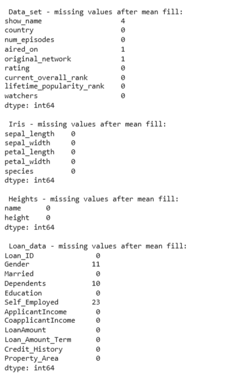

```py
#DROP NULL VALUES
cleaned = {}

for name, df in datasets.items():
    result = df.drop_duplicates().copy()
    for col in result.select_dtypes(include=np.number).columns:
        result[col] = result[col].fillna(result[col].median())
    for col in result.select_dtypes(exclude=np.number).columns:
        if result[col].isnull().any() and not result[col].mode().empty:
            result[col] = result[col].fillna(result[col].mode()[0])
    cleaned[name] = result
    result.to_csv('/content/' + name.lower() + '_cleaned.csv', index=False)
    print(name, '- remaining nulls:', result.isnull().sum().sum(),
          '| duplicate rows:', result.duplicated().sum())

```
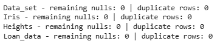

```py
import pandas as pd
import seaborn as sns
import matplotlib.pyplot as plt
```


```py
age=[1,3,28,27,25,92,30,39,40,50,26,24,29,94]
af=pd.DataFrame(age)
af
#USE BOXPLOT FUNCTION HERE TO DETECT OUTLIER
for name, df in cleaned.items():
    for col in df.select_dtypes(include=np.number).columns:
        if df[col].dropna().empty:
            continue
        plt.figure(figsize=(6, 2))
        sns.boxplot(x=df[col])
        plt.title(name + ' - ' + col + ' (Before IQR)')
        plt.show()


```
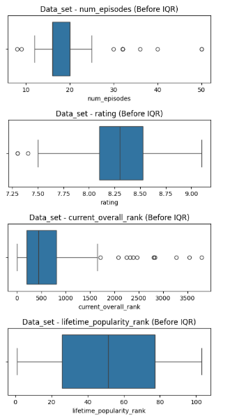

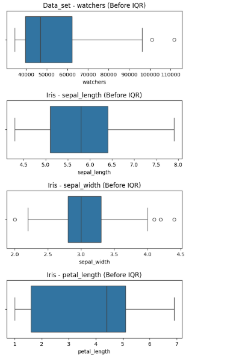

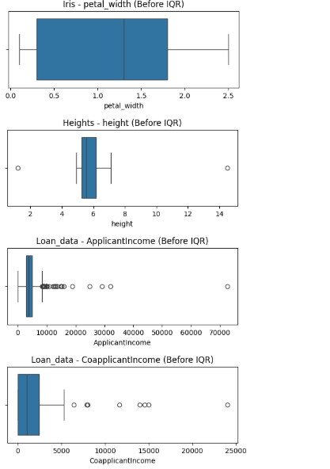

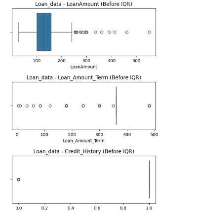

```py

#PERFORM IQR METHOD AND DETECT OUTLIER VALUES
iqr_masks = {}

for name, df in cleaned.items():
    mask = pd.Series(False, index=df.index)
    for col in df.select_dtypes(include=np.number).columns:
        q1 = df[col].quantile(0.25)
        q3 = df[col].quantile(0.75)
        iqr = q3 - q1
        lower = q1 - 1.5 * iqr
        upper = q3 + 1.5 * iqr
        col_mask = (df[col] < lower) | (df[col] > upper)
        print('\n', name, '-', col, '| Lower:', lower, '| Upper:', upper)
        print('Outlier values:')
        display(df.loc[col_mask, [col]])
        mask |= col_mask
    iqr_masks[name] = mask
```

```

 Data_set - num_episodes | Lower: 10.0 | Upper: 26.0
Outlier values:
num_episodes
11	32
21	32
28	40
46	30
60	32
65	8
68	36
70	50
73	50
81	9
84	32
89	32


 Data_set - rating | Lower: 7.462499999999999 | Upper: 9.162500000000001
Outlier values:
rating
31	7.3
58	7.3
96	7.4

 Data_set - current_overall_rank | Lower: -716.875 | Upper: 1716.125
Outlier values:
current_overall_rank
3	2249.0
7	2817.0
23	2383.0
31	3788.0
38	2083.0
43	2803.0
45	2835.0
55	2325.0
56	2466.0
58	3541.0
72	1717.0
96	3271.0

 Data_set - lifetime_popularity_rank | Lower: -51.5 | Upper: 154.5
Outlier values:
lifetime_popularity_rank

 Data_set - watchers | Lower: 5551.625 | Upper: 96352.625
Outlier values:
watchers
0	111706.0
1	100950.0

 Iris - sepal_length | Lower: 3.1499999999999986 | Upper: 8.350000000000001
Outlier values:
sepal_length

 Iris - sepal_width | Lower: 2.05 | Upper: 4.05
Outlier values:
sepal_width
15	4.4
32	4.1
33	4.2
60	2.0

 Iris - petal_length | Lower: -3.649999999999999 | Upper: 10.349999999999998
Outlier values:
petal_length

 Iris - petal_width | Lower: -1.95 | Upper: 4.05
Outlier values:
petal_width

 Heights - height | Lower: 3.8625000000000003 | Upper: 7.5625
Outlier values:
height
9	14.5
12	1.2

 Loan_data - ApplicantIncome | Lower: -430.0 | Upper: 8354.0
Outlier values:
ApplicantIncome
8	13633
13	12173
18	9226
81	72529
83	8449
91	13518
98	9719
124	12500
143	32000
144	10890
145	12941
147	8703
179	15312
184	10166
187	9167
188	13083
194	10000
200	8706
230	14911
247	10000
263	18840
272	24797
279	29167
283	9000
284	10000
285	8750
302	14987
323	16000
331	9699
350	8667
360	8550
366	9200

 Loan_data - CoapplicantIncome | Lower: -3645.75 | Upper: 6076.25
Outlier values:
CoapplicantIncome
18	7916
25	24000
85	8000
123	6414
230	14507
237	13983
284	11666
351	15000

 Loan_data - LoanAmount | Lower: 16.25 | Upper: 242.25
Outlier values:
LoanAmount
8	280.0
18	300.0
24	290.0
27	275.0
81	360.0
83	257.0
91	390.0
96	256.0
124	300.0
143	550.0
144	260.0
189	336.0
194	412.0
284	460.0
285	297.0
331	300.0
345	260.0
350	254.0

 Loan_data - Loan_Amount_Term | Lower: 360.0 | Upper: 360.0
Outlier values:
Loan_Amount_Term
8	240.0
12	180.0
19	180.0
21	180.0
29	180.0
36	180.0
53	180.0
57	180.0
59	180.0
72	60.0
82	480.0
84	180.0
85	180.0
101	480.0
103	180.0
128	180.0
134	84.0
141	240.0
144	12.0
145	300.0
155	300.0
157	350.0
164	240.0
173	180.0
190	84.0
200	480.0
215	300.0
216	36.0
222	480.0
223	300.0
232	180.0
239	480.0
245	180.0
249	180.0
250	480.0
251	300.0
266	480.0
277	180.0
295	480.0
312	84.0
314	300.0
315	180.0
322	120.0
325	6.0
338	240.0
340	180.0
342	180.0
349	300.0
354	180.0
366	180.0

 Loan_data - Credit_History | Lower: 1.0 | Upper: 1.0
Outlier values:
Credit_History
7	0.0
13	0.0
25	0.0
35	0.0
55	0.0
58	0.0
63	0.0
66	0.0
67	0.0
69	0.0
80	0.0
82	0.0
84	0.0
94	0.0
101	0.0
106	0.0
117	0.0
118	0.0
119	0.0
123	0.0
124	0.0
126	0.0
140	0.0
142	0.0
147	0.0
153	0.0
161	0.0
165	0.0
166	0.0
168	0.0
173	0.0
174	0.0
192	0.0
193	0.0
196	0.0
198	0.0
211	0.0
224	0.0
229	0.0
235	0.0
236	0.0
241	0.0
243	0.0
245	0.0
250	0.0
255	0.0
266	0.0
268	0.0
273	0.0
274	0.0
278	0.0
293	0.0
301	0.0
311	0.0
317	0.0
325	0.0
339	0.0
346	0.0
354	0.0


```

```py
#REMOVE OUTLIERS
iqr_cleaned = {}

for name, df in cleaned.items():
    result = df.loc[~iqr_masks[name]].copy()
    iqr_cleaned[name] = result
    result.to_csv('/content/' + name.lower() + '_iqr_cleaned.csv', index=False)
    print(name, '- rows before:', len(df), '| rows after:', len(result))
    #USE BOXPLOT FUNCTION HERE TO CHECK OUTLIER IS REMOVED
for name, df in iqr_cleaned.items():
    for col in df.select_dtypes(include=np.number).columns:
        if df[col].dropna().empty:
            continue
        plt.figure(figsize=(6, 2))
        sns.boxplot(x=df[col])
        plt.title(name + ' - ' + col + ' (After IQR)')
        plt.show()sult = df.loc[~iqr_masks[name]].copy()
    iqr_cleaned[name] = result
    result.to_csv('/content/' + name.lower() + '_iqr_cleaned.csv', index=False)
    print(name, '- rows before:', len(df), '| rows after:', len(result))
```
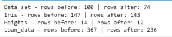

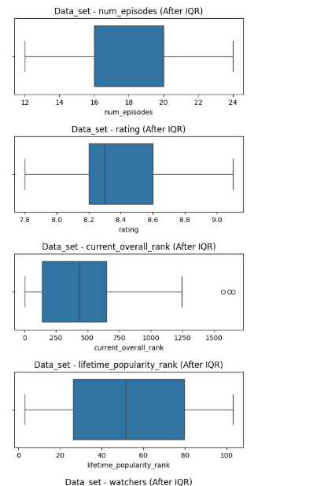

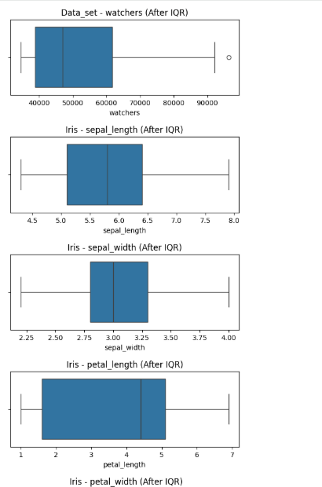

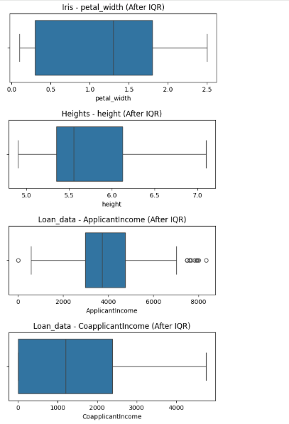

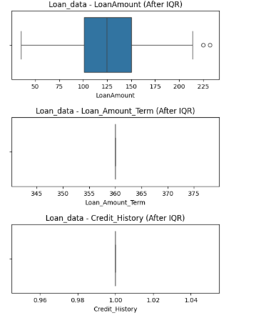


```py
from scipy import stats #STATS METHOD IS USED TO IMPLEMENT Z SCORE METHOD
```


```py
data=[1,12,15,18,21,24,27,30,33,36,39,42,45,48,51,54,57,60,63,66,69,72,75,78,81,84,87,90,93,96,99,158]
df=pd.DataFrame(data)
```


```py
#USE BOXPLOT FUNCTION HERE TO DETECT OUTLIER
for name, df in cleaned.items():
    for col in df.select_dtypes(include=np.number).columns:
        if df[col].dropna().empty:
            continue
        plt.figure(figsize=(6, 2))
        sns.boxplot(x=df[col])
        plt.title(name + ' - ' + col + ' (Before Z-score)')
        plt.show()
```

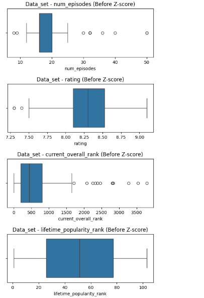

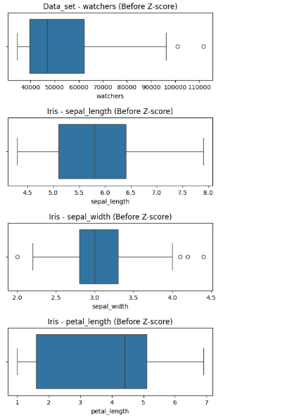

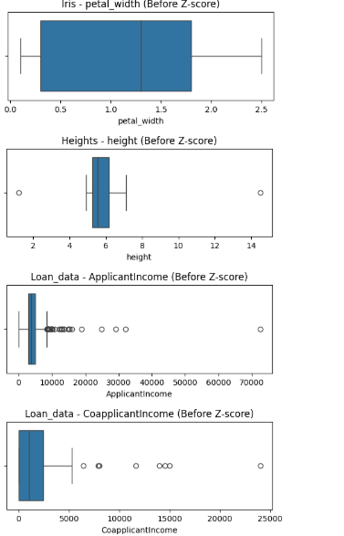

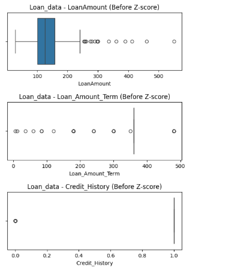

```py
#PERFORM Z SCORE METHOD AND DETECT OUTLIER VALUES
z_masks = {}

for name, df in cleaned.items():
    mask = pd.Series(False, index=df.index)
    for col in df.select_dtypes(include=np.number).columns:
        values = df[col].astype(float)
        if values.dropna().empty or values.std(ddof=0) == 0:
            continue
        z_scores = pd.Series(
            np.abs(stats.zscore(values, nan_policy='omit')),
            index=df.index
        )
        col_mask = z_scores > 3
        print('\n', name, '-', col, 'Z-score outliers:')
        display(df.loc[col_mask, [col]])
        mask |= col_mask
    z_masks[name] = mask
```
```

 Data_set - num_episodes Z-score outliers:
num_episodes
28	40
70	50
73	50


 Data_set - rating Z-score outliers:
rating

 Data_set - current_overall_rank Z-score outliers:
current_overall_rank
31	3788.0
58	3541.0
96	3271.0

 Data_set - lifetime_popularity_rank Z-score outliers:
lifetime_popularity_rank

 Data_set - watchers Z-score outliers:
watchers
0	111706.0

 Iris - sepal_length Z-score outliers:
sepal_length

 Iris - sepal_width Z-score outliers:
sepal_width
15	4.4

 Iris - petal_length Z-score outliers:
petal_length

 Iris - petal_width Z-score outliers:
petal_width

 Heights - height Z-score outliers:
height
9	14.5

 Loan_data - ApplicantIncome Z-score outliers:
ApplicantIncome
81	72529
143	32000
272	24797
279	29167

 Loan_data - CoapplicantIncome Z-score outliers:
CoapplicantIncome
25	24000
230	14507
237	13983
284	11666
351	15000

 Loan_data - LoanAmount Z-score outliers:
LoanAmount
81	360.0
91	390.0
143	550.0
189	336.0
194	412.0
284	460.0

 Loan_data - Loan_Amount_Term Z-score outliers:
Loan_Amount_Term
72	60.0
134	84.0
144	12.0
190	84.0
216	36.0
312	84.0
322	120.0
325	6.0

 Loan_data - Credit_History Z-score outliers:
Credit_History

```

```py
#REMOVE OUTLIERS
zscore_cleaned = {}

for name, df in cleaned.items():
    result = df.loc[~z_masks[name]].copy()
    zscore_cleaned[name] = result
    result.to_csv('/content/' + name.lower() + '_zscore_cleaned.csv', index=False)
    print(name, '- rows before:', len(df), '| rows after:', len(result))
```

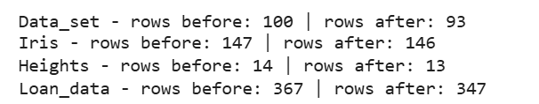

```py
#USE BOXPLOT FUNCTION HERE TO CHECK OUTLIER IS REMOVED
for name, df in zscore_cleaned.items():
    for col in df.select_dtypes(include=np.number).columns:
        if df[col].dropna().empty:
            continue
        plt.figure(figsize=(6, 2))
        sns.boxplot(x=df[col])
        plt.title(name + ' - ' + col + ' (After Z-score)')
        plt.show()
```


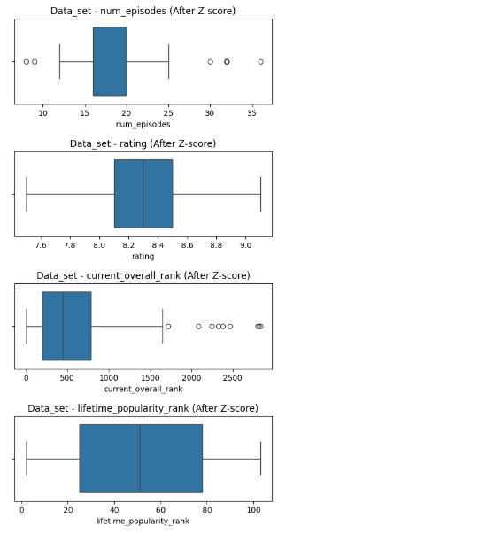

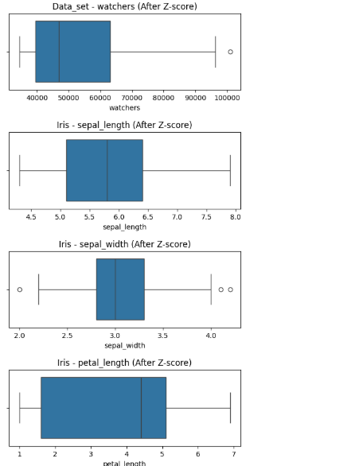

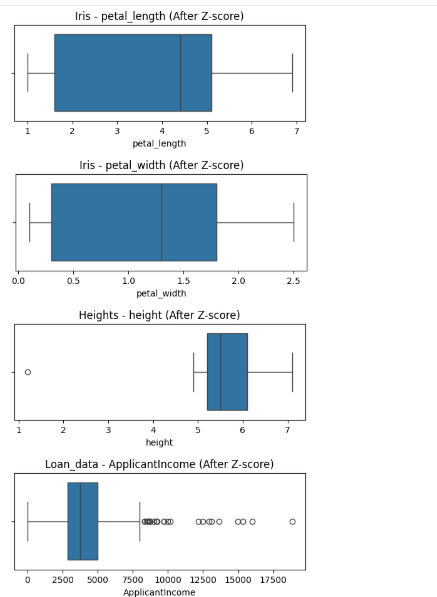

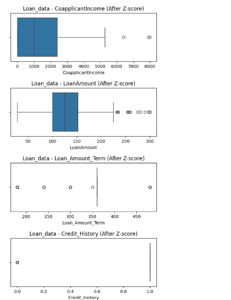


# Result
The four datasets were successfully analyzed and cleaned by handling missing values and removing duplicate records. Outliers were detected and removed using the IQR and Z-score methods. The cleaned datasets were saved as CSV files for further analysis.
